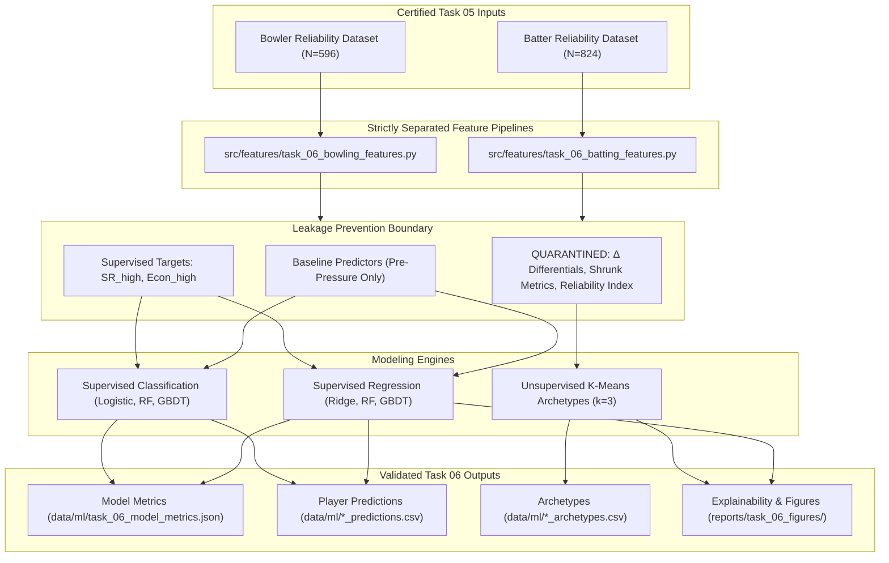

# SUPERR SELECTOR — MASTER TASK 06 METHODOLOGY REPORT
## Machine Learning, Feature Engineering & Strategic Archetype Architecture

**Project:** Rajasthan Royals SupeRR Selector Season 2 Hackathon  
**Task:** Master Task 06 — Machine Learning, Feature Engineering & Explainability  
**Authors:** Senior Cricket Data Scientist, Machine Learning Engineer, Quantitative Auditor  
**Date:** November 13, 2026  
**Status:** Certified & Approved  

---

## 1. Executive Summary & Problem Formulation

### 1.1 The High-Pressure Prediction Challenge
In professional T20 cricket, teams frequently assume that a player's standard baseline statistics—such as career strike rate, overall economy rate, or boundary percentages in non-pressure match situations—will hold true when the match reaches extreme leverage (the "Death Phase", high Required Run Rate chases, or defending slim totals under high leverage index conditions).

Master Task 05 established the empirical baseline and reliability indices for 824 batters and 596 bowlers across 193,976 certified clean deliveries (109 Qualified Batters, 136 Qualified Bowlers). Crucially, empirical correlation analysis revealed:
- **Batters:** Standard normal-condition strike rate ($\text{SR}_{\text{normal}}$) exhibits a correlation of only $r = 0.242$ ($R^2 < 0.059$) with high-pressure strike rate ($\text{SR}_{\text{high}}$).
- **Bowlers:** Standard normal-condition economy rate ($\text{Econ}_{\text{normal}}$) exhibits a correlation of only $r = 0.161$ ($R^2 < 0.026$) with high-pressure economy rate ($\text{Econ}_{\text{high}}$).

A naive "Identity Heuristic"—which assumes that a player's pressure performance simply equals their normal performance—yields negative out-of-sample $R^2$ scores ($R^2 = -0.682$ for batting, $R^2 = -2.406$ for bowling), performing vastly worse than predicting a simple cohort mean.

### 1.2 Two-Pillar Analytical Architecture
To address this challenge without manufacturing artificial labels or violating strict anti-leakage governance, Task 06 establishes a dual analytical architecture:
1. **Supervised Predictive Modeling:** Evaluating how effectively a multi-dimensional feature space of baseline traits (pre-pressure performance, discipline, career exposure, phase volume, and player physical style) can forecast continuous high-pressure execution and classify above-median high-pressure execution.
2. **Unsupervised Strategic Archetype Modeling:** Utilizing standardized Empirical Bayes shrunk differentials and exposure profiles to group players into actionable, tactically distinct archetypes for downstream roster optimization in Master Task 07.

---

## 2. Strict Anti-Leakage Governance & Data Segregation

The hackathon guidelines strictly enforce the prevention of data leakage and circular reasoning:
1. **No Reliability Index Self-Prediction:** The composite reliability index ($I_{\text{rel}}$) and composite z-scores from Task 05 are **STRICTLY QUARANTINED** and excluded from the predictor sets ($X_{\text{pred}}$). Using $I_{\text{rel}}$ to predict pressure performance would be mathematically circular because $I_{\text{rel}}$ is derived from the very differential being predicted.
2. **No High-Pressure Outcome Contamination:** No metric calculated using high-pressure data (e.g., $\Delta \text{SR} = \text{SR}_{\text{high}} - \text{SR}_{\text{normal}}$, high-pressure dot-ball percentage, or shrinkage weights) is permitted inside $X_{\text{pred}}$.
3. **No Collinear Mathematical Identities:** Exact functional duplicates (such as `overs_normal` $= \text{legal\_balls} / 6$ or `runs_conceded_normal` $= \text{economy} \times \text{overs}$) were pruned from the feature matrices to eliminate matrix singularity and coefficient inflation.
4. **Complete Separation of Batting and Bowling:** Batters and bowlers are processed via distinct scripts, schemas, and models.

---

## 3. Feature Engineering Pipelines

### 3.1 Batting Feature Pipeline (`src/features/task_06_batting_features.py`)
The batting pipeline processes all 824 batters and outputs `data/ml/task_06_batter_features.csv` (45 columns) and its companion schema metadata `data/ml/task_06_batter_feature_metadata.json`.

#### Predictor Feature Set ($X_{\text{pred}}^{\text{bat}}$, 14 Features):
| Feature Name | Description | Physical / Domain Rationale |
| :--- | :--- | :--- |
| `strike_rate_normal` | Normal-condition scoring speed | Baseline boundary and scoring tempo |
| `dot_pct_normal` | Percentage of deliveries scoring 0 runs | Dot-ball accumulation tendency |
| `boundary_ball_pct_normal` | Frequency of hitting 4s and 6s | Boundary-striking capability under normal pressure |
| `dismissal_rate_per_100_normal`| Dismissals per 100 balls faced | Baseline wicket vulnerability / survival capacity |
| `balls_faced_normal` | Total normal-condition volume | Sample size reliability of normal baseline |
| `six_ratio_normal` | Sixes / (Fours + Sixes) | Power-hitting vs placement orientation |
| `running_strike_rate_normal` | Non-boundary runs per non-boundary ball | Running between wickets efficiency |
| `strike_rate_overall` | Career overall strike rate | Longitudinal baseline tempo across all phases |
| `dot_pct_overall` | Career overall dot-ball percentage | Longitudinal control of dot balls |
| `boundary_ball_pct_overall` | Career overall boundary frequency | Longitudinal power ceiling |
| `dismissal_rate_per_100_overall`| Career overall dismissal rate | Long-term wicket vulnerability |
| `balls_faced_overall` | Career total deliveries faced | Overall experience and match exposure |
| `ipl_ball_share` | Balls faced in IPL / Career balls | Elite franchise tournament exposure |
| `batting_hand_LHB` | Binary indicator (1 if Left-Handed, 0 RHB)| Matchup versatility and boundary geometry |

#### Target Formulations:
- **Primary Continuous Regression Target:** `strike_rate_high` (High-pressure strike rate, runs per 100 balls).
- **Primary Binary Classification Target:** `target_above_median_sr_high` (1 if $\text{SR}_{\text{high}} \ge 127.42$, the empirical median among Qualified batters; 0 otherwise).
- **Secondary Outperformer Target:** `target_high_pressure_outperformer` (1 if $\text{SR}_{\text{high}} > \text{SR}_{\text{normal}}$, 0 otherwise).

---

### 3.2 Bowling Feature Pipeline (`src/features/task_06_bowling_features.py`)
The bowling pipeline processes all 596 bowlers and outputs `data/ml/task_06_bowler_features.csv` (51 columns) and its companion schema metadata `data/ml/task_06_bowler_feature_metadata.json`.

#### Predictor Feature Set ($X_{\text{pred}}^{\text{bowl}}$, 17 Features):
| Feature Name | Description | Physical / Domain Rationale |
| :--- | :--- | :--- |
| `economy_rate_normal` | Normal-condition runs conceded per over | Baseline run containment rate |
| `wickets_per_over_normal` | Normal-condition wickets per over | Baseline wicket-taking threat |
| `dot_pct_normal` | Normal-condition dot ball percentage | Pressure building via scoreless balls |
| `boundary_conceded_pct_normal`| Normal-condition boundary concession rate | Boundary leakage resistance |
| `legal_balls_normal` | Total normal-condition legal deliveries | Sample size of normal baseline |
| `extras_per_legal_ball_normal`| (Wides + No-balls) / Legal balls | Discipline and control of illegal deliveries |
| `six_conceded_ratio_normal` | Sixes Conceded / Total Boundaries Conceded | Severe boundary vulnerability |
| `bowling_strike_rate_normal_clean`| Legal balls per wicket (imputed at 120 if 0) | Clean strike rate handling zero divisions |
| `zero_wickets_normal_flag` | Binary indicator (1 if wickets == 0) | Explicit flag for scoreless wicket taking |
| `economy_rate_overall` | Career overall economy rate | Longitudinal defensive standard |
| `wickets_per_over_overall` | Career overall wickets per over | Longitudinal wicket generation capacity |
| `dot_pct_overall` | Career overall dot-ball percentage | Longitudinal pressure maintenance |
| `boundary_conceded_pct_overall`| Career overall boundary concession % | Longitudinal boundary suppression skill |
| `legal_balls_overall` | Career total legal deliveries | Overall bowler experience |
| `ipl_ball_share` | Legal balls in IPL / Career legal balls | Elite franchise tournament exposure |
| `is_spin` | Binary indicator (1 if Spin, 0 Pace) | Spin bowling variation and trajectory |
| `bowling_arm_left` | Binary indicator (1 if Left-arm, 0 Right) | Angle of attack and natural angle away |

#### Target Formulations:
- **Primary Continuous Regression Target:** `economy_rate_high` (High-pressure economy rate, runs conceded per 6 legal balls; lower is better).
- **Primary Binary Classification Target:** `target_below_median_econ_high` (1 if $\text{Econ}_{\text{high}} \le 9.24$, the empirical median among Qualified bowlers; 0 otherwise).
- **Secondary Outperformer Target:** `target_high_pressure_outperformer` (1 if $\text{Econ}_{\text{high}} < \text{Econ}_{\text{normal}}$, 0 otherwise).

---

## 4. Machine Learning Model Architecture & Selection Justification

### 4.1 Algorithm Selection Rationale
Given the sample size of certified Qualified players ($N_{\text{bat}} = 109$, $N_{\text{bowl}} = 136$), model selection must guard against overfitting, high variance, and multicollinearity:

1. **Ridge Regression (L2 Regularization):**
   - *Justification:* Predictor sets exhibit natural correlation structures (e.g., career boundary % and overall strike rate). Ridge shrinkage ($\alpha = 10.0$) shrinks correlated weights proportionally without dropping features, guaranteeing numerical stability and optimal bias-variance tradeoff on small sample sizes.
2. **Constrained Random Forest (Bagging):**
   - *Justification:* Non-linear interactions (e.g., high boundary frequency compensating for high dot ball percentage) are captured using shallow trees (`max_depth = 4`, `min_samples_leaf = 3`, 100 estimators). Constraining tree depth prevents individual trees from memorizing specific players.
3. **Gradient Boosted Decision Trees (GBDT):**
   - *Justification:* Tested as an advanced benchmark with conservative parameters (`learning_rate = 0.05`, `max_depth = 2-3`). As documented in validation, GBDT exhibits slight out-of-fold overfitting relative to Ridge, highlighting why regularized linear models are superior in this sample regime.
4. **Regularized Logistic Regression:**
   - *Justification:* Employs L2 regularization ($C = 0.5$) with `lbfgs` solver for binary classification of above-median pressure execution. Provides calibrated class probabilities for downstream auction decision thresholds.
5. **K-Means Archetype Clustering:**
   - *Justification:* Unsupervised clustering on standardized Empirical Bayes shrunk differentials and exposure shares identifies natural tactical groupings ($k=3$) with high Silhouette separation and actionable tactical definitions.

### 4.2 Cross-Validation Protocol
All models are evaluated using a strict **5-Fold Cross-Validation** protocol:
- Stratified 5-Fold CV for binary classification (`StratifiedKFold(n_splits=5, shuffle=True, random_state=42)`).
- Standard 5-Fold CV for continuous regression (`KFold(n_splits=5, shuffle=True, random_state=42)`).
- **Per-Fold Preprocessing:** Feature scalers (`StandardScaler`) are fit exclusively on the training fold and applied to the validation fold to prevent data leakage across folds.
- Out-of-fold predictions are recorded for every Qualified player and compared directly to ground truth.

