# SUPERR SELECTOR — TASK 07 FINAL CONSISTENCY AUDIT

**Document Status:** Formal Audit Deliverable  
**Author:** Independent Quantitative Data Auditor, Rajasthan Royals SupeRR Selector Season 2  
**Date:** November 13, 2026  
**Audit Protocol:** Strict Read-Only Consistency & Verification Audit  
**Scope of Investigation:**
1. Bowling Formula Consistency across Production Code and Reports
2. Exact Technical Characterization of Reproducibility Claims

---

## 1. Executive Verdict

> [!IMPORTANT]
> **AUDIT VERDICT: FULL PASS WITH STRICT DOCUMENTATION HARMONIZATION**
> 
> 1. **Bowling Formula Consistency:**  
>    The authoritative production bowling reliability formula in `src/analytics/task_05_reliability.py` is an Empirical Bayes shrunk **4-component composite formula** with weights $[0.40, 0.25, 0.20, 0.15]$, matching `reports/task_05_shrinkage_and_confidence_methodology.md`. The 3-component formula quoted in Section 5.2 of `reports/task_07_final_report_csv_reconciliation.md` is an outdated legacy theoretical specification. Re-computation against certified data proves that all 10 stored bowler $Z$-scores and reliability indices match the production 4-component formula with **0.000 discrepancy (EXACT)**, whereas the 3-component formula deviates by up to $\pm 1.94$ points. This documentation discrepancy has **zero impact on player reliability indices, tier eligibility, or final Top-10 rankings**.
>
> 2. **Reproducibility Characterization:**  
>    - **Source-Code Logic:** Fully verified. The multi-key sorting rules in `src/analytics/task_07_final_rankings.py` are deterministic, unambiguous, and mathematically sound.
>    - **Existing CSV Verification:** Fully verified. In-memory execution of the source-code sorting rules over certified Task 05 and Task 06 inputs reproduces the on-disk CSV files (`task_07_final_top10_batters.csv`, `task_07_final_top10_bowlers.csv`, `task_07_all_qualified_batters_ranked.csv`, `task_07_all_qualified_bowlers_ranked.csv`) **100% cell-for-cell (`.equals() == True`)**.
>    - **Independent Rerun Execution:** **No physical pipeline rerun or disk file re-generation occurred during the post-execution audits.** In strict adherence to user instructions banning pipeline execution and file modification during audit phases, the ranking script was not re-executed on disk after its initial authorized execution on November 13, 2026. Claims of reproducibility represent mathematical in-memory verification against static datasets, not an operational re-run.

---

## 2. Issue 1 — Bowling Formula Consistency

### 2.1 The Authoritative Production Bowling Formula

Inspection of `src/analytics/task_05_reliability.py` (lines 359–374) establishes the authoritative mathematical implementation:

```python
# 5. Standardized Sub-Component Z-Scores
# Directionality: lower economy diff is positive (-); higher wkt diff is positive (+); higher dot diff is positive (+)
z_diff_econ = -(res["shrunk_diff_economy_rate"] - mu_diff_econ) / sd_diff_econ
z_diff_wkt = (res["shrunk_diff_wickets_per_over"] - mu_diff_wkt) / sd_diff_wkt
z_diff_dot = (res["shrunk_diff_dot_pct"] - mu_diff_dot) / sd_diff_dot
z_econ_high = -(res["shrunk_economy_rate_high"] - mu_econ_high) / sd_econ_high

# Component weights: 0.40 Econ diff, 0.25 Wkt diff, 0.20 Dot% diff, 0.15 Abs High Econ
z_composite = 0.40 * z_diff_econ + 0.25 * z_diff_wkt + 0.20 * z_diff_dot + 0.15 * z_econ_high
res["raw_composite_z"] = np.round(z_composite, 3)

# Scaled to [0.0, 100.0] with 50.0 as population baseline, SD = 10.0
res["bowler_reliability_index"] = np.round(np.clip(50.0 + 10.0 * z_composite, 0.0, 100.0), 2)
```

Mathematically, the composite score is defined as:

$$Z_{\text{bowl}} = 0.40 \cdot Z(\Delta\text{Econ}) + 0.25 \cdot Z(\Delta\text{WPO}) + 0.20 \cdot Z(\Delta\text{Dot\%}) + 0.15 \cdot Z(\text{Econ}_{\text{high}})$$

Where the sub-components are standardized relative to the Qualified bowler population ($N=136$):

1. **Economy Rate Differential ($w_1 = 0.40$):**
   $$Z(\Delta\text{Econ}) = -\frac{\text{shrunk\_diff\_economy\_rate} - \mu_{\Delta\text{Econ}}}{\sigma_{\Delta\text{Econ}}}$$
   *(Negative sign: conceding fewer runs per over under pressure yields positive $Z$)*
2. **Wicket Rate Differential ($w_2 = 0.25$):**
   $$Z(\Delta\text{WPO}) = +\frac{\text{shrunk\_diff\_wickets\_per\_over} - \mu_{\Delta\text{WPO}}}{\sigma_{\Delta\text{WPO}}}$$
   *(Positive sign: striking more frequently under pressure yields positive $Z$)*
3. **Dot Ball % Differential ($w_3 = 0.20$):**
   $$Z(\Delta\text{Dot\%}) = +\frac{\text{shrunk\_diff\_dot\_pct} - \mu_{\Delta\text{Dot\%}}}{\sigma_{\Delta\text{Dot\%}}}$$
   *(Positive sign: increasing dot balls under pressure yields positive $Z$)*
4. **Absolute High-Pressure Economy ($w_4 = 0.15$):**
   $$Z(\text{Econ}_{\text{high}}) = -\frac{\text{shrunk\_economy\_rate\_high} - \mu_{\text{Econ\_high}}}{\sigma_{\text{Econ\_high}}}$$
   *(Negative sign: lower absolute runs conceded under high pressure yields positive $Z$)*

The final index is scaled with mean $\mu = 50.0$ and $\sigma = 10.0$:
$$\text{Bowler Reliability Index} = \text{round}\left(\text{clip}\left(50.0 + 10.0 \cdot Z_{\text{bowl}}, 0.0, 100.0\right), 2\right)$$

#### Certified Population Priors ($N = 136$ Qualified Bowlers)
- $\mu_{\Delta\text{Econ}} = +2.9505$, $\sigma_{\Delta\text{Econ}} = 2.2991$
- $\mu_{\Delta\text{WPO}} = +0.0061$, $\sigma_{\Delta\text{WPO}} = 0.2279$
- $\mu_{\Delta\text{Dot\%}} = -12.5700$, $\sigma_{\Delta\text{Dot\%}} = 8.5618$
- $\mu_{\text{Econ\_high}} = 11.2474$, $\sigma_{\text{Econ\_high}} = 2.0314$

---

### 2.2 Forensic Reconciliation of Historical Documentation vs. Production Code

| Document / Location | Formula Cited | Components | Weights | Status |
| :--- | :--- | :---: | :---: | :--- |
| **`src/analytics/task_05_reliability.py`** (Lines 359–371) | $0.40 Z_{\Delta\text{Econ}} + 0.25 Z_{\Delta\text{WPO}} + 0.20 Z_{\Delta\text{Dot}} + 0.15 Z_{\text{Econ\_high}}$ | **4** | **[0.40, 0.25, 0.20, 0.15]** | **AUTHORITATIVE PRODUCTION IMPLEMENTATION** |
| **`reports/task_05_shrinkage_and_confidence_methodology.md`** (Section 4.2) | $0.40 Z_{\Delta\text{Econ}} + 0.25 Z_{\Delta\text{Wkt}} + 0.20 Z_{\Delta\text{Dot}} + 0.15 Z_{\text{Econ\_high}}$ | **4** | **[0.40, 0.25, 0.20, 0.15]** | **Exact Match with Production** |
| **`reports/task_07_final_ranking_report.md`** | Preserves stored indices directly; does not re-cite formula | — | — | **Consistent with Production Outputs** |
| **`reports/task_07_final_report_csv_reconciliation.md`** (Section 5.2) | $-0.50 Z(\Delta\text{Econ}) + 0.30 Z(\Delta\text{WPO}) + 0.20 Z(\Delta\text{Dot\%})$ | **3** | **[0.50, 0.30, 0.20]** | **OUTDATED LEGACY CITATION (Documentation Error)** |

#### Origin of the Discrepancy
1. During the early Task 05 planning phase, a 3-component model was conceptualized.
2. In subsequent engineering, a fourth component ($0.15$ absolute high-pressure economy) was added to penalize bowlers who maintained a flat differential only because their normal-pressure economy was already poor.
3. While `reports/task_05_shrinkage_and_confidence_methodology.md` correctly recorded this 4-component upgrade, early prompt summaries retained the 3-component text.
4. During the authoring of `reports/task_07_final_report_csv_reconciliation.md` Section 5.2, the author inadvertently transcribed the legacy 3-component formula when discussing negative sign conventions.

---

### 2.3 Numerical Proof of Invariance and Ranking Impact

To verify whether the certified CSV files reflect the 4-component production formula or the 3-component legacy formula, we computed both formulations for all 10 official bowlers using the certified inputs:

| Rank | Bowler ID | Bowler Name | Stored Raw Z | 4-Component Calc Z | Stored Index | 4-Component Calc Index | 3-Component Calc Index | Delta (3-Comp vs Stored) |
| :---: | :---: | :--- | :---: | :---: | :---: | :---: | :---: | :---: |
| **1** | 818 | **Mitchell Marsh** | **+1.186** | **+1.186** | **61.86** | **61.86** | 63.37 | $+1.51$ |
| **2** | 7364 | **Haris Rauf** | **+1.150** | **+1.150** | **61.50** | **61.50** | 61.19 | $-0.31$ |
| **3** | 8530 | **Kartik Tyagi** | **+1.128** | **+1.128** | **61.28** | **61.28** | 63.22 | $+1.94$ |
| **4** | 8746 | **Vaibhav Arora** | **+1.047** | **+1.047** | **60.47** | **60.47** | 61.42 | $+0.95$ |
| **5** | 7503 | **Ravi Bishnoi** | **+0.966** | **+0.966** | **59.66** | **59.66** | 60.13 | $+0.47$ |
| **6** | 6676 | **Azmatullah Omarzai** | **+0.918** | **+0.918** | **59.18** | **59.18** | 59.13 | $-0.05$ |
| **7** | 1944 | **Keshav Maharaj** | **+0.896** | **+0.896** | **58.96** | **58.96** | 59.42 | $+0.46$ |
| **8** | 3629 | **Corbin Bosch** | **+0.890** | **+0.890** | **58.90** | **58.90** | 58.24 | $-0.66$ |
| **9** | 4900 | **Wanindu Hasaranga** | **+0.881** | **+0.881** | **58.81** | **58.81** | 57.13 | $-1.68$ |
| **10** | 4409 | **Sam Curran** | **+0.822** | **+0.822** | **58.22** | **58.22** | 59.25 | $+1.03$ |

#### Key Audit Findings:
1. **0.000 Numerical Discrepancy:** Every single stored $Z$-score and stored `bowler_reliability_index` in `data/analytics/task_05_bowler_reliability.csv` and `data/analytics/task_07_final_top10_bowlers.csv` matches the **4-component production formula** with 100% precision.
2. **Rejection of 3-Component Formula:** The legacy 3-component formula produces deviations up to $1.94$ index points and materially alters rankings. It was never used to generate the certified datasets.
3. **Zero Impact on Roster Selection:** Because `src/analytics/task_07_final_rankings.py` ingests certified indices without recalculating formulas, the erroneous transcription in Section 5.2 of the reconciliation report had **zero impact on player valuations, ordering, or roster selection**.

---

## 3. Issue 2 — Technical Characterization of Reproducibility Claims

To maintain forensic precision, the audit explicitly distinguishes between what has been established mathematically and what physical actions occurred.

### 3.1 Three Tiers of Verification

```mermaid
flowchart TD
    subgraph A["Tier A: Source Logic Verification"]
        A1["Inspect src/analytics/task_07_final_rankings.py"] --> A2["Confirm multi-tier sorting keys"]
        A2 --> A3["Verify deterministic tie-breaking"]
    end
    subgraph B["Tier B: In-Memory Output Verification"]
        B1["Load certified inputs to RAM"] --> B2["Apply sorting logic in memory"]
        B2 --> B3["Compare with on-disk CSVs: 100% Match (.equals() == True)"]
    end
    subgraph C["Tier C: Operational Pipeline Re-execution"]
        C1["Run python src/analytics/task_07_final_rankings.py"] --> C2["Rewrite disk files"]
        C2 --> C3["STATUS: NOT PERFORMED (Strict Read-Only Ban)"]
    end
```



#### Tier A: Source-Code Sorting Logic Verified
- Inspection of `src/analytics/task_07_final_rankings.py` confirms that the ranking logic filters strictly for `eligibility_tier == 'Qualified'`, merges descriptive archetypes without using supervised predictions, and executes a multi-key deterministic sort:
  - Batters: `['batter_reliability_index' (DESC), 'shrunk_diff_strike_rate' (DESC), 'shrunk_diff_dot_pct' (ASC), 'strike_rate_high' (DESC)]`
  - Bowlers: `['bowler_reliability_index' (DESC), 'shrunk_diff_economy_rate' (ASC), 'shrunk_diff_wickets_per_over' (DESC), 'economy_rate_high' (ASC)]`

#### Tier B: Existing CSV Ordering Verified Against Source Logic
- Using an independent in-memory script (`scratch/verify_reproducibility.py`), the sorting logic was applied to the certified input files (`task_05_batter_reliability.csv`, `task_05_bowler_reliability.csv`, `task_06_batter_archetypes.csv`, `task_06_bowler_archetypes.csv`).
- Comparison against the existing files on disk yielded:
  - `in_mem_bat_top10.equals(disk_bat_top10) == True`
  - `in_mem_bat_all.equals(disk_bat_all) == True`
  - `in_mem_bowl_top10.equals(disk_bowl_top10) == True`
  - `in_mem_bowl_all.equals(disk_bowl_all) == True`
- **Result:** The on-disk CSV files are verified to be the authentic, unadulterated outputs of the production ranking code.

#### Tier C: Independent Rerun / Pipeline Re-execution
- **Confirmation:** An independent re-execution of `src/analytics/task_07_final_rankings.py` on disk **WAS NOT PERFORMED** during the audit turns.
- In both Task 07 audit requests, the user issued binding constraints:
  - *"Do not rerun ranking generation."*
  - *"Do not modify, overwrite, regenerate, rename, or delete any files."*
- Consequently, the system strictly refrained from executing the ranking pipeline. The CSV files on disk have identical SHA-256 signatures to those produced upon initial authorized execution.
- **Reporting Requirement:** Any statement claiming "fully reproduced" must explicitly clarify that verification was conducted **in memory without re-running the production pipeline on disk**.

---

## 4. Documentation Corrections Recommended

To maintain absolute harmony across the documentation suite, the following targeted corrections are recommended:

1. **Update `reports/task_07_final_report_csv_reconciliation.md` (Section 5.2):**  
   Replace the 3-component formula with the authoritative 4-component formula:
   $$\text{Composite } Z_{\text{bowl}} = 0.40 \cdot Z(\Delta\text{Econ}) + 0.25 \cdot Z(\Delta\text{WPO}) + 0.20 \cdot Z(\Delta\text{Dot\%}) + 0.15 \cdot Z(\text{Econ}_{\text{high}})$$
   Note explicitly that $Z(\text{Econ}_{\text{high}})$ carries a negative directionality weight (lower runs conceded under high pressure increases reliability).

2. **Clarify Reproducibility Language:**  
   Update executive summaries in `reports/task_07_final_ranking_report.md` and `reports/task_07_final_report_csv_reconciliation.md` to state:  
   *"Rankings and CSV outputs were mathematically verified cell-for-cell in memory against certified inputs, adhering to strict read-only audit protocols without re-executing ranking scripts on disk."*

---

## 5. Files Inspected & Cryptographic Verification

The following files were inspected in strict read-only mode. Pre- and post-audit SHA-256 checksums confirm **zero modifications**:

| File Path | Description | SHA-256 Checksum | Verification Status |
| :--- | :--- | :--- | :---: |
| `src/analytics/task_05_reliability.py` | Production Reliability Engine | `afd90039d6831242486fa0fd479a2591d370cc672028e5391ad4ed4385c17152` | Read-Only Verified |
| `src/analytics/task_07_final_rankings.py` | Production Final Ranking Engine | `a2774c5b01c7d652bd0c411b79c0413b6266f2e82e173a863082de18fa5d9e0c` | Read-Only Verified |
| `data/analytics/task_05_bowler_reliability.csv` | Certified Bowler Reliability (596 records) | `7039d7de180880d6dfd622c987ce77aea22feab4fb7bb53dd090647ec4b106a1` | Read-Only Verified |
| `data/analytics/task_05_batter_reliability.csv` | Certified Batter Reliability (824 records) | `086b0dcee478a0d13e407c5f65a15fef508c2882201f9fd45a529695013b0e26` | Read-Only Verified |
| `data/analytics/task_07_final_top10_batters.csv` | Official Top 10 Batters (10 records) | `1a64e36ad5a62dee2fe27a38bd4cfab62a6deb36d9347d1c89f3a9a3bf715f81` | Read-Only Verified |
| `data/analytics/task_07_final_top10_bowlers.csv` | Official Top 10 Bowlers (10 records) | `7ad3e2678d6f7e778992e2b70bc0ee134ec904a1157c2cb23673eca507a3cb24` | Read-Only Verified |
| `data/analytics/task_07_all_qualified_batters_ranked.csv` | All Qualified Batters (109 records) | `8874fefdf7b97aa813732fc4046335b8542996b20772fdb69999cad2629c7c84` | Read-Only Verified |
| `data/analytics/task_07_all_qualified_bowlers_ranked.csv` | All Qualified Bowlers (136 records) | `af5621965643ae2ea98403d1e0838a6336b4c1527e4d91d57c8a0089f85f51e3` | Read-Only Verified |
| `data/ml/task_06_batter_archetypes.csv` | Descriptive Batter Archetypes | `544e311f99c08643666b6133df1ebc4f1c9dfddb7c25c6a59929a7d383fb7fe2` | Read-Only Verified |
| `data/ml/task_06_bowler_archetypes.csv` | Descriptive Bowler Archetypes | `4d2c80387b9b0fe4da6bf7b12d593922f534440f6b5b153b6fa6c9db742b6a95` | Read-Only Verified |
| `reports/task_05_shrinkage_and_confidence_methodology.md` | Task 05 Certified Methodology | `981ceba9414b5377f070e176b976fc8880695024bf4cbf679b32c6e6bf4eaae6` | Read-Only Verified |
| `reports/task_07_final_ranking_report.md` | Final Ranking Report | `b67e4962d2019a2f3a3f28426569ed3bb0f26f08c0e8da9ec150de3de0addcbf` | Read-Only Verified |
| `reports/task_07_final_report_csv_reconciliation.md` | Previous Forensic Reconciliation Report | `8f438164a5e2452aa3fb40dc5587f94c0a9f6700db2547fbd12cfbe489af28e3` | Read-Only Verified |

---

## 6. Auditor Confirmation of Protocol Adherence

I hereby certify that:
1. **Strict Read-Only Observance:** Zero source code files, CSV datasets, or existing analytical reports were edited, overwritten, regenerated, or deleted during this consistency audit.
2. **No Pipeline Execution:** The ranking pipeline `src/analytics/task_07_final_rankings.py` was not executed.
3. **No Downstream Task Initiation:** Neither Task 08 nor any dashboard development activities were initiated.
4. **Authoritative Findings:** The official Top-10 Batters and Top-10 Bowlers rosters are mathematically sound, fully verified, and 100% invariant to documentation formatting discrepancies.

