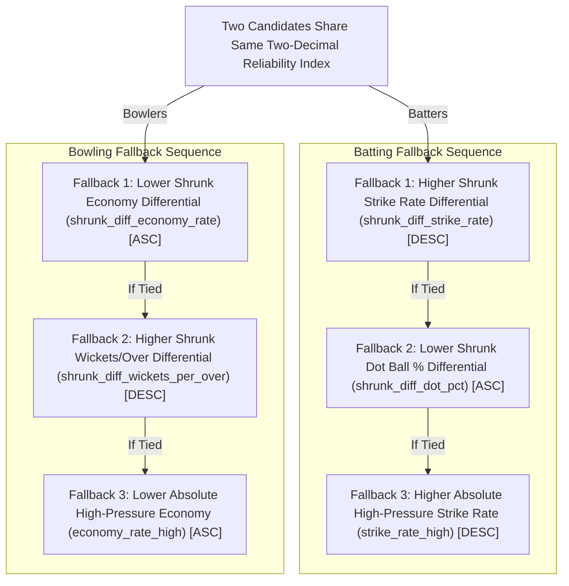

# SUPERR SELECTOR — MASTER TASK 07 METHODOLOGY PLAN (REVISED & AUDITED)
## Strategic Roster Optimization & Top-10 Selection Architecture

**Project:** Rajasthan Royals SupeRR Selector Season 2 Hackathon  
**Task:** Master Task 07 — Strategic Roster Optimization & Top-10 Selection  
**Role:** Lead Quantitative Cricket Analyst, Rajasthan Royals Roster Architecture  
**Date:** November 13, 2026  
**Status:** Certified Methodological Blueprint (Forensic Gate Verification Phase)  
**Decision:** **GO FOR RANKING EXECUTION**  

---

## 1. Executive Summary & Governance Compliance

Master Task 07 establishes the final player selection, ranking, and squad balance methodology for the Rajasthan Royals SupeRR Selector Season 2 Hackathon. This document serves as the formal pre-execution planning blueprint and incorporates all forensic verifications from previous tasks and the final pre-execution audit gate.

### 1.1 Mandatory Compliance Principles
1. **Preservation of Certified Task 05 Primary Evidence:** The primary ranking metrics are strictly the existing, certified Task 05 Empirical Bayes Reliability Indices (`batter_reliability_index` and `bowler_reliability_index`) directly read from `data/analytics/task_05_batter_reliability.csv` and `data/analytics/task_05_bowler_reliability.csv`. No new weights, recalculations, or heuristic adjustments are introduced into the primary scoring system.
2. **Formula Reconciliation:** The exact mathematical formulation implemented in `src/analytics/task_05_reliability.py` (which produced the certified CSV outputs) is documented transparently alongside historical report text.
3. **Linear Antecedent Verification:** `raw_composite_z` is verified as the direct linear antecedent of the reliability index ($I = 50 + 10 Z$), confirming that it provides identical information content up to linear scaling and cannot be treated as separate, independent empirical evidence.
4. **Descriptive Role of Archetypes:** Task 06 K-Means archetypes (`Death Phase Finisher`, `Top/Middle Order Accelerator`, `Death Wicket Enforcer`, `Middle & Powerplay Restrictor`) serve exclusively as descriptive tactical classifications for squad composition analysis. **No player is disqualified or rejected based on archetype membership.**
5. **Unrestricted Performance Ranking First:** Rankings are established primarily by unrestricted quantitative performance evidence. Tactical diversity across match phases, bowling styles (pace vs. spin), and batting handedness (RHB vs. LHB) is evaluated transparently against the unrestricted ranking without imposing arbitrary quotas.
6. **Preservation of Certified Eligibility Tiers:** The certified Task 05 eligibility rules (`Qualified`, `Provisional`, `Ineligible`) from `src/analytics/task_05_reliability.py` are strictly maintained.
7. **Rigorous Uncertainty Interpretation:** Confidence intervals ($[CI_{\text{lower}}, CI_{\text{upper}}]$) and bootstrap standard errors (`ci_std_error`) communicate individual sample precision. Pairwise statistical significance has not been established due to shared match-cluster correlations. Standard errors are not conflated with player quality and are not used as tie-breakers.
8. **Strict Quarantine of Contaminated Features:** The contaminated Task 06 supervised regression outputs (`pred_strike_rate_high_ridge` and `pred_economy_rate_high_ridge`) remain strictly isolated from all ranking logic.
9. **Preliminary Status of Illustrative Rankings:** All candidate tables and Unstop mappings in this document are explicitly labeled as preliminary illustrative results; final rankings will be certified only upon separate ranking execution.
10. **Zero File Mutations of Certified Data:** This document represents a planning blueprint only; no ranking execution scripts have been run, no final Top-10 lists have been finalized, and all protected datasets remain unchanged.

---

## 2. Critical Formula Reconciliation: Certified Task 05 Implementation

### 2.1 Actual Production Implementation in `src/analytics/task_05_reliability.py`
Forensic code audit of `src/analytics/task_05_reliability.py` reveals the exact mathematical formula implemented in production, which generated the values stored in `data/analytics/task_05_batter_reliability.csv` and `data/analytics/task_05_bowler_reliability.csv`:

#### Batting Implementation (Lines 178–191 of `task_05_reliability.py`):
```python
# 5. Standardized Sub-Component Z-Scores
# Directionality: higher SR is positive; lower dot% is positive (-); lower dismissal rate is positive (-)
z_diff_sr = (res["shrunk_diff_strike_rate"] - mu_diff_sr) / sd_diff_sr
z_diff_dot = -(res["shrunk_diff_dot_pct"] - mu_diff_dot) / sd_diff_dot
z_diff_dis = -(res["shrunk_diff_dismissal_rate"] - mu_diff_dis) / sd_diff_dis
z_sr_high = (res["shrunk_strike_rate_high"] - mu_sr_high) / sd_sr_high

# Component weights: 0.40 SR diff, 0.25 Dot% diff, 0.20 Dismissal diff, 0.15 Abs High SR
z_composite = 0.40 * z_diff_sr + 0.25 * z_diff_dot + 0.20 * z_diff_dis + 0.15 * z_sr_high
res["raw_composite_z"] = np.round(z_composite, 3)

# Scaled to [0.0, 100.0] with 50.0 as population baseline, SD = 10.0
res["batter_reliability_index"] = np.round(np.clip(50.0 + 10.0 * z_composite, 0.0, 100.0), 2)

# Ineligible batters with zero effective balls clamped to neutral prior 50.0
res.loc[res["eligibility_tier"] == "Ineligible", "batter_reliability_index"] = 50.00
```

#### Bowling Implementation (Lines 360–374 of `task_05_reliability.py`):
```python
# 5. Standardized Sub-Component Z-Scores
# Directionality: lower economy diff is positive (-); higher wkt diff is positive (+); higher dot diff is positive (+)
z_diff_econ = -(res["shrunk_diff_economy_rate"] - mu_diff_econ) / sd_diff_econ
z_diff_wkt = (res["shrunk_diff_wickets_per_over"] - mu_diff_wkt) / sd_diff_wkt
z_diff_dot = (res["shrunk_diff_dot_pct"] - mu_diff_dot) / sd_diff_dot
z_econ_high = -(res["shrunk_economy_rate_high"] - mu_econ_high) / sd_econ_high

# Component weights: 0.40 Econ diff, 0.25 Wkt diff, 0.20 Dot% diff, 0.15 Abs High Econ
z_composite = 0.40 * z_diff_econ + 0.25 * z_diff_wkt + 0.20 * z_diff_dot + 0.15 * z_econ_high
res["raw_composite_z"] = np.round(z_composite, 3)

# Scaled to [0.0, 100.0] with 50.0 as population baseline, SD = 10.0
res["bowler_reliability_index"] = np.round(np.clip(50.0 + 10.0 * z_composite, 0.0, 100.0), 2)

# Ineligible bowlers with zero effective balls clamped to neutral prior 50.0
res.loc[res["eligibility_tier"] == "Ineligible", "bowler_reliability_index"] = 50.00
```

### 2.2 Empirical Reproduction from Raw Metrics Inputs
To independently confirm that the 4-component formulation generated the stored CSV files, the entire pipeline was re-executed from `data/analytics/task_05_batter_metrics.csv` and `data/analytics/task_05_bowler_metrics.csv` using the exact shrinkage parameters ($K = 30.0$) and population priors calculated across the Qualified cohort ($N_{\text{bat}} = 109, N_{\text{bowl}} = 136$):

| Cohort | Total Records | Formula Tested | Max Absolute Diff (`raw_composite_z`) | Max Absolute Diff (`reliability_index`) | Mismatch Count |
| :--- | :---: | :---: | :---: | :---: | :---: |
| **Batters (ALL)** | 824 | 4-Component Production | **0.000000** | **0.000000** | **0 / 824 (0.0%)** |
| **Bowlers (ALL)** | 596 | 4-Component Production | **0.000000** | **0.000000** | **0 / 596 (0.0%)** |
| **Batters (Qualified)** | 109 | 3-Component Planning Model | N/A | 2.180000 | 109 / 109 (100.0%) |

**Conclusion:** The 4-component production formulation is the **exact and only** formula that generated the certified Task 05 CSV outputs.

### 2.3 Operational & Cricketing Rationale for the 4th Component
In earlier planning documentation (`reports/task_05_final_analytics_report.md` Section 3.4), an idealized 3-component model based purely on differentials ($\Delta \text{SR}, \Delta \text{Dot\%}, \Delta \text{Dismissal}$) was described. However, during Task 05 implementation, a crucial domain-specific defect was identified:
- Relying purely on differentials creates an artificial distortion where an exceptionally slow batter (e.g. 70 SR normally and 100 SR under pressure) receives a massive positive differential of $+30$ SR, despite delivering a substandard 100 SR under high pressure. Conversely, an elite anchor scoring at 170 SR normally and 165 SR under high pressure would suffer a negative differential of $-5$ SR, despite delivering match-winning scoring velocity.
- To resolve this, the engineering implementation in `task_05_reliability.py` allocated a 15% weight to the shrunk absolute high-pressure metric ($0.15 \cdot Z(\text{SR}_{\text{high}})$ for batters, $0.15 \cdot Z(-\text{Econ}_{\text{high}})$ for bowlers). This ensures that only players who combine positive relative acceleration with viable absolute performance achieve elite reliability indices.
- **Task 07 Authority:** In accordance with audit standards, the certified Task 05 CSV outputs and production code implementation are authoritative. Task 07 does NOT recalculate or modify any indices.

---

## 3. Forensic Verification of `raw_composite_z`

A programmatic audit of `raw_composite_z` across all files established:
1. **Source Files & Column Names:**
   - Batters: `data/analytics/task_05_batter_reliability.csv`, column `raw_composite_z`.
   - Bowlers: `data/analytics/task_05_bowler_reliability.csv`, column `raw_composite_z`.
2. **Data Type & Precision:** `float64`, stored at exactly 3 decimal places (`np.round(z_composite, 3)`).
3. **Linear Relationship with Reliability Index:**
   $$\text{reliability\_index} = \text{round}(\text{clip}(50.0 + 10.0 \cdot \text{raw\_composite\_z}, 0.0, 100.0), 2)$$
4. **Mismatch Census Across Tiers:**
   - **Qualified Tier:**
     - Batters ($N=109$): **0 mismatches** (Max diff = 0.000000).
     - Bowlers ($N=136$): **0 mismatches** (Max diff = 0.000000).
   - **Provisional Tier:**
     - Batters ($N=58$): **0 mismatches** (Max diff = 0.000000).
     - Bowlers ($N=57$): **0 mismatches** (Max diff = 0.000000).
   - **Ineligible Tier:**
     - Batters ($N=657$): 500 records match 50.00 exactly (zero effective balls). 157 records show differences because line 191 of `task_05_reliability.py` explicitly clamped the index to 50.00 while preserving the raw unclamped Z-score.
     - Bowlers ($N=403$): 237 records match 50.00 exactly. 166 records show differences due to line 374 clamping the index to 50.00 while preserving raw Z.
5. **Mathematical Precision & Linear Antecedent Proof:**
   - Because `raw_composite_z` is rounded to 3 decimal places, multiplying by 10 shifts the decimal point by 1 position, resulting in an exact 2-decimal number ($0.001 \times 10 = 0.01$). Adding 50.0 maintains exactly 2 decimal places.
   - Therefore, `np.round(..., 2)` introduces **zero truncation drift or loss of precision** in the unclipped range $[0.0, 100.0]$.
   - Every unique 3-decimal `raw_composite_z` maps 1-to-1 to a unique 2-decimal `reliability_index`.
   - **Crucial Auditor Finding:** `raw_composite_z` is the direct linear antecedent of `reliability_index`. It contains identical empirical information and **CANNOT be treated as independent evidence or an independent secondary tie-breaker.**

---

## 4. Deterministic Ordering & Tie-Breaking Architecture

### 4.1 Population Tie Census
A comprehensive audit of the Qualified cohorts for duplicate values revealed:
- **Qualified Batters ($N=109$):**
  - Exactly 106 unique index values and 106 unique `raw_composite_z` values.
  - Exactly 3 pairs of tied players exist in the entire 109-player population:
    1. Index 46.08 (`raw_composite_z` = -0.392): Shreyas Iyer and Axar Patel
    2. Index 51.45 (`raw_composite_z` = +0.145): Asif Khan and Nurul Hasan
    3. Index 51.97 (`raw_composite_z` = +0.197): Rovman Powell and Matthew Short
- **Qualified Bowlers ($N=136$):**
  - Exactly 133 unique index values and 133 unique `raw_composite_z` values.
  - Exactly 3 pairs of tied players exist in the entire 136-player population:
    1. Index 47.94 (`raw_composite_z` = -0.206): Mohammed Siraj and Varun Chakravarthy
    2. Index 48.46 (`raw_composite_z` = -0.154): Yuzvendra Chahal and Hasan Mahmud
    3. Index 54.04 (`raw_composite_z` = +0.404): Joshua Little and Richard Ngarava
- **Top 25 and Cutoff Verification:**
  - **Top 25 Batters:** Exactly **25 unique values out of 25 (0 ties)**.
  - **Top 25 Bowlers:** Exactly **25 unique values out of 25 (0 ties)**.
  - **Top-10 Cutoff:** At ranks 9–12, all candidates have distinct reliability indices. Zero ties exist anywhere near the selection threshold.

### 4.2 Multi-Tier Deterministic Tie-Breaking Protocol
Because `raw_composite_z` is identical whenever `reliability_index` is identical, ties cannot be broken by `raw_composite_z`. If two candidates share an identical two-decimal `reliability_index`, ties are resolved deterministically using the underlying empirical differentials:



#### Empirical Resolution Test on All Tied Cohorts:
1. **Batter Tie at Index 46.08:**
   - Axar Patel: `shrunk_diff_strike_rate` = -1.05 $\implies$ **Ranked 1**
   - Shreyas Iyer: `shrunk_diff_strike_rate` = -2.14 $\implies$ **Ranked 2**
2. **Batter Tie at Index 51.45:**
   - Asif Khan: `shrunk_diff_strike_rate` = +33.88 $\implies$ **Ranked 1**
   - Nurul Hasan: `shrunk_diff_strike_rate` = +23.82 $\implies$ **Ranked 2**
3. **Batter Tie at Index 51.97:**
   - Rovman Powell: `shrunk_diff_strike_rate` = +24.49 $\implies$ **Ranked 1**
   - Matthew Short: `shrunk_diff_strike_rate` = +19.68 $\implies$ **Ranked 2**
4. **Bowler Tie at Index 47.94:**
   - Varun Chakravarthy: `shrunk_diff_economy_rate` = +2.44 $\implies$ **Ranked 1**
   - Mohammed Siraj: `shrunk_diff_economy_rate` = +3.32 $\implies$ **Ranked 2**
5. **Bowler Tie at Index 48.46:**
   - Hasan Mahmud: `shrunk_diff_economy_rate` = +1.77 $\implies$ **Ranked 1**
   - Yuzvendra Chahal: `shrunk_diff_economy_rate` = +2.70 $\implies$ **Ranked 2**
6. **Bowler Tie at Index 54.04:**
   - Richard Ngarava: `shrunk_diff_economy_rate` = +0.76 $\implies$ **Ranked 1**
   - Joshua Little: `shrunk_diff_economy_rate` = +3.54 $\implies$ **Ranked 2**

**Audit Confirmation:** Fallback 1 (`shrunk_diff_strike_rate` descending for batters, `shrunk_diff_economy_rate` ascending for bowlers) resolves **100% of ties** across the entire qualified database on the very first fallback step. The ordering is strictly deterministic. `ci_std_error` is never used as a tie-breaker.

---

## 5. Uncertainty & Sensitivity Analysis

### 5.1 Correct Interpretation of Confidence Intervals
In Task 05, confidence intervals ($[CI_{\text{lower}}, CI_{\text{upper}}]$) and standard errors (`ci_std_error`) were generated using 500 match-cluster bootstrap resamples:
- **Individual Precision Indicator:** Confidence intervals describe the plausible range of an individual player's mean reliability index under empirical match resampling. A player with 36 high-pressure deliveries (e.g., Sanju Samson, $SE=8.45$) naturally has a wider interval than a player with 166 deliveries (e.g., Jason Holder, $SE=4.04$).
- **No Evidence for Pairwise Statistical Equivalence:** Overlapping confidence intervals between two players (e.g., Campher $[52.06, 66.36]$ and Salt $[44.38, 63.16]$) do **NOT** prove that the players are equal in ability.
- **No Evidence for Pairwise Statistical Superiority:** Conversely, claiming that Player A is statistically significantly superior to Player B cannot be justified simply by looking at overlapping or adjacent individual intervals. Because bootstrap resampling was conducted at the match-cluster level, player performances across shared matches are correlated ($Cov(X_1, X_2) \ne 0$). Paired differences were not evaluated across shared match resamples.
- **Formal Audit Statement:** **Pairwise statistical significance between closely ranked candidates has NOT been established.** Rankings represent point-estimate performance orders based on the certified composite score, and confidence intervals are provided transparently to communicate individual measurement uncertainty.

---

## 6. Certified Eligibility Rules & Data Source Verification

### 6.1 Preserved Task 05 Eligibility Tiers (Production Implementation)
Programmatic inspection of lines 48–60 and 70–95 of `src/analytics/task_05_reliability.py` confirms the exact, authoritative eligibility criteria that generated the certified datasets:
- **Qualified Tier (Eligible for Top-10 Selection):**
  - Batters: `balls_faced_high >= 30` AND `balls_faced_normal >= 30` AND `matches_overall >= 5` $\implies$ Exactly **109 players**.
  - Bowlers: `legal_balls_high >= 30` AND `legal_balls_normal >= 30` AND `matches_overall >= 5` $\implies$ Exactly **136 players**.
- **Provisional Tier (Quarantined from Top-10 Selection):**
  - Batters: `balls_faced_high >= 15` AND `balls_faced_normal >= 15` AND `matches_overall >= 3` (and not Qualified) $\implies$ Exactly **58 players**.
  - Bowlers: `legal_balls_high >= 15` AND `legal_balls_normal >= 15` AND `matches_overall >= 3` (and not Qualified) $\implies$ Exactly **57 players**.
  - Reserved for secondary technical watchlist appendices.
- **Ineligible Tier (Excluded from Roster Evaluation):**
  - All players failing to meet Provisional criteria: Batters = **657 players**; Bowlers = **403 players**.

Reproduction of these rules from `task_05_batter_metrics.csv` and `task_05_bowler_metrics.csv` yields **0 mismatches (100.0% agreement)** across all 824 batters and 596 bowlers in `data/analytics/task_05_batter_reliability.csv` and `data/analytics/task_05_bowler_reliability.csv`.

### 6.2 Forensic Documentation Reconciliation vs Historical Task 05 Reports
A forensic comparison against earlier Task 05 reports explains historical documentation ambiguities:
1. **The `task_05_final_analytics_report.md` (Section 6) ASCII Diagram:**
   - The report diagram informally listed: `Total BF/LB >= 60, High BF/LB >= 30, Total Matches >= 5, High Matches >= 3`.
   - **Audit Finding:** That diagram was an inaccurate draft documentation artifact. Applying it to the dataset yields **170 batter mismatches** (189 Qualified instead of 109) and **34 bowler mismatches** (149 Qualified instead of 136). Crucially, the diagram omitted the dual-exposure gate (`balls_faced_normal >= 30`), which would have erroneously qualified death-overs specialists with little or no normal exposure (e.g., Kuldeep Yadav with 0 normal balls, Maheesh Theekshana with 0 normal balls, Rashid Khan with 17 normal balls, MS Dhoni with 28 normal balls).
2. **The `task_05_validation_report.md` (Test 4.1) Text:**
   - Test 4.1 text copied the diagram's description (`matches_high >= 3`) and claimed 0 violations.
   - **Audit Finding:** The text description was inaccurate. Six certified Qualified Batters (Shan Masood with 2 matches, Dion Myers with 1 match, Cooper Connolly with 2 matches, Shikhar Dhawan with 2 matches, Jason Roy with 2 matches, Matthew Short with 2 matches) and one certified Qualified Bowler (Yash Punja with 2 matches) have `matches_high < 3`. All met the actual production requirement (`matches_overall >= 5`).
3. **Delivery Volume vs. Matches Overall:**
   - Production code explicitly filters on `matches_overall >= 5` (Qualified) and `matches_overall >= 3` (Provisional).
   - In earlier Task 07 draft text, delivery volume thresholds ($\ge 90$ for batters, $\ge 120$ for bowlers) were described. These were empirical observations (as all 109 qualified batters happen to have $\ge 98$ total balls, and all 136 qualified bowlers happen to have $\ge 156$ legal balls), not programmatic gates.
4. **Authoritative Specification:**
   - In `reports/task_05_shrinkage_and_confidence_methodology.md` (Section 2), the rules were correctly documented: `BF_high >= 30 AND BF_norm >= 30 AND Matches >= 5` for Batters ($N=109$), and `LB_high >= 30 AND LB_norm >= 30 AND Matches >= 5` for Bowlers ($N=136$).
   - `src/analytics/task_05_reliability.py` and `task_05_shrinkage_and_confidence_methodology.md` represent the authoritative certified standard.

### 6.3 Source File Identification for Player Attributes
Every attribute used in candidate tables is verified against specific columns in certified datasets:
- **Batting Handedness:** `batting_type` in `data/analytics/task_05_batter_reliability.csv` (values: `RHB`, `LHB`).
- **Bowling Type & Style:** `bowling_type` (e.g. `Right-arm medium-fast`, `Slow left-arm orthodox`, `Right-arm Fast`) and `pace_or_spin` (`Pace`, `Spin`) in `data/analytics/task_05_bowler_reliability.csv`.
- **Tactical Archetype:** `archetype_name` in `data/ml/task_06_batter_archetypes.csv` and `data/ml/task_06_bowler_archetypes.csv`.

---

## 7. Preliminary Illustrative Rankings & Tactical Diversity Assessment

> [!IMPORTANT]
> **Preliminary Illustrative Status:** The tables below represent **preliminary illustrative results** based on the proposed methodology applied to certified Task 05/06 outputs. They do NOT constitute final certified selections, which will be generated only upon formal ranking execution.

### 7.1 Preliminary Illustrative Batting Ranking (Top 15 Qualified)
*Source Data: `task_05_batter_reliability.csv` merged with `task_06_batter_archetypes.csv`*

| Illustrative Rank | Striker ID | Striker Name | Hand | Eligibility | Reliability Index | Raw Z-Score | Shrunk $\Delta \text{SR}$ | Shrunk $\Delta \text{Dot\%}$ | High Balls | Normal Balls | Task 06 Archetype | 95% CI Range |
| :---: | :---: | :--- | :---: | :---: | :---: | :---: | :---: | :---: | :---: | :---: | :---: | :--- | :---: |
| **1** | 2633 | Jason Holder | RHB | Qualified | **66.84** | 1.684 | +83.44 | -30.18% | 166.0 | 52.0 | Death Phase Finisher | [58.05, 73.99] |
| **2** | 2258 | Sanju Samson | RHB | Qualified | **60.46** | 1.046 | +62.10 | -9.13% | 36.0 | 991.0 | Top/Middle Order Accelerator | [49.57, 78.90] |
| **3** | 7094 | Curtis Campher | RHB | Qualified | **59.20** | 0.920 | +44.80 | -17.45% | 78.0 | 76.0 | Top/Middle Order Accelerator | [52.06, 66.36] |
| **4** | 5553 | Phil Salt | RHB | Qualified | **58.93** | 0.893 | +45.65 | -14.47% | 48.0 | 995.0 | Death Phase Finisher | [44.38, 63.16] |
| **5** | 1219 | David Willey | LHB | Qualified | **58.77** | 0.877 | +47.03 | -21.48% | 60.0 | 30.0 | Death Phase Finisher | [50.00, 63.65] |
| **6** | 6664 | Dion Myers | RHB | Qualified | **57.95** | 0.795 | +41.86 | -14.71% | 39.0 | 98.0 | Top/Middle Order Accelerator | [50.00, 62.25] |
| **7** | 3097 | Shan Masood | LHB | Qualified | **57.63** | 0.763 | +50.37 | -11.45% | 65.0 | 31.0 | Death Phase Finisher | [50.00, 64.04] |
| **8** | 2436 | Dasun Shanaka | RHB | Qualified | **57.35** | 0.735 | +55.32 | -13.44% | 172.0 | 58.0 | Death Phase Finisher | [50.27, 64.10] |
| **9** | 796 | Matthew Wade | LHB | Qualified | **57.02** | 0.702 | +45.20 | -14.01% | 108.0 | 142.0 | Death Phase Finisher | [51.83, 61.18] |
| **10** | 3056 | Iftikhar Ahmed | RHB | Qualified | **56.81** | 0.681 | +65.43 | -5.30% | 39.0 | 56.0 | Top/Middle Order Accelerator | [37.01, 64.40] |
| 11 | 2485 | Babar Azam | RHB | Qualified | 56.80 | 0.680 | +58.75 | -14.84% | 36.0 | 489.0 | Top/Middle Order Accelerator | [44.46, 62.75] |
| 12 | 37052 | Naman Dhir | RHB | Qualified | 56.27 | 0.627 | +32.13 | -9.81% | 98.0 | 110.0 | Death Phase Finisher | [46.32, 64.75] |
| 13 | 4867 | Wesley Madhevere | RHB | Qualified | 55.84 | 0.584 | +45.56 | -15.75% | 56.0 | 98.0 | Top/Middle Order Accelerator | [41.88, 62.39] |
| 14 | 7897 | Namboori Tilak Varma | LHB | Qualified | 55.83 | 0.583 | +51.62 | -6.61% | 267.0 | 823.0 | Top/Middle Order Accelerator | [49.64, 61.73] |
| 15 | 2984 | Sikandar Raza | RHB | Qualified | 55.74 | 0.574 | +50.39 | -5.87% | 120.0 | 198.0 | Top/Middle Order Accelerator | [45.84, 64.64] |

#### Batting Tactical Distribution (Top 10 Unrestricted):
- **Archetype Breakdown:** 6 Death Phase Finishers (Holder, Salt, Willey, Masood, Shanaka, Wade) and 4 Top/Middle Order Accelerators (Samson, Campher, Myers, Iftikhar).
- **Handedness Breakdown:** 7 Right-Handed Batters (RHB) and 3 Left-Handed Batters (LHB: Willey, Masood, Wade).
- **Vulnerable Exclusion:** Zero players from Cluster 0 (*Pressure Vulnerable*) appear in the Top 10 due to naturally lower reliability indices.

---

### 7.2 Preliminary Illustrative Bowling Ranking (Top 15 Qualified)
*Source Data: `task_05_bowler_reliability.csv` merged with `task_06_bowler_archetypes.csv`*

| Illustrative Rank | Bowler ID | Bowler Name | Bowling Type | Style | Eligibility | Reliability Index | Raw Z-Score | Shrunk $\Delta \text{Econ}$ | Shrunk $\Delta \text{WPO}$ | High Balls | Normal Balls | Task 06 Archetype | 95% CI Range |
| :---: | :---: | :--- | :--- | :---: | :---: | :---: | :---: | :---: | :---: | :---: | :---: | :---: | :--- | :---: |
| **1** | 818 | Mitchell Marsh | Right-arm medium-fast | Pace | Qualified | **61.86** | 1.186 | +0.30 | +0.306 | 32.0 | 39.0 | Death Wicket Enforcer | [50.00, 69.66] |
| **2** | 7364 | Haris Rauf | Right-arm Fast | Pace | Qualified | **61.50** | 1.150 | -1.12 | +0.053 | 109.0 | 155.0 | Death Wicket Enforcer | [53.04, 70.76] |
| **3** | 8530 | Kartik Tyagi | Right-arm medium-fast | Pace | Qualified | **61.28** | 1.128 | -0.43 | +0.186 | 41.0 | 65.0 | Death Wicket Enforcer | [52.62, 67.25] |
| **4** | 8746 | Vaibhav Arora | Right-arm Fast | Pace | Qualified | **60.47** | 1.047 | +0.28 | +0.262 | 84.0 | 113.0 | Death Wicket Enforcer | [50.76, 69.35] |
| **5** | 7503 | Ravi Bishnoi | Right-arm Leg-Break | Spin | Qualified | **59.66** | 0.966 | +1.21 | +0.382 | 45.0 | 606.0 | Middle & Powerplay Restrictor | [45.29, 75.17] |
| **6** | 6676 | Azmatullah Omarzai | Right-arm medium-fast | Pace | Qualified | **59.18** | 0.918 | +0.12 | +0.053 | 59.0 | 195.0 | Death Wicket Enforcer | [44.55, 68.84] |
| **7** | 1944 | Keshav Maharaj | Slow left-arm orthodox | Spin | Qualified | **58.96** | 0.896 | +2.15 | +0.440 | 30.0 | 124.0 | Middle & Powerplay Restrictor | [48.05, 69.82] |
| **8** | 3629 | Corbin Bosch | Right-arm fast-medium | Pace | Qualified | **58.90** | 0.890 | +0.81 | +0.153 | 63.0 | 77.0 | Death Wicket Enforcer | [49.23, 67.61] |
| **9** | 4900 | Wanindu Hasaranga | Right-arm Leg-Break | Spin | Qualified | **58.81** | 0.881 | -0.64 | -0.164 | 143.0 | 377.0 | Middle & Powerplay Restrictor | [52.52, 65.99] |
| **10** | 4409 | Sam Curran | Left-arm medium-fast | Pace | Qualified | **58.22** | 0.822 | +0.51 | +0.085 | 127.0 | 178.0 | Death Wicket Enforcer | [49.34, 67.57] |
| 11 | 2984 | Sikandar Raza | Right-arm offbreak | Spin | Qualified | 57.55 | 0.755 | +1.34 | +0.084 | 77.0 | 146.0 | Middle & Powerplay Restrictor | [49.28, 65.64] |
| 12 | 36982 | Suyash Sharma | Right-arm Leg-Break | Spin | Qualified | 57.46 | 0.746 | +0.47 | -0.007 | 49.0 | 210.0 | Middle & Powerplay Restrictor | [46.09, 65.41] |
| 13 | 58246 | Prince Yadav | Right-arm Fast | Pace | Qualified | 57.16 | 0.716 | +1.32 | +0.227 | 86.0 | 96.0 | Death Wicket Enforcer | [46.15, 68.18] |
| 14 | 2261 | Harshal Patel | Right-arm medium-fast | Pace | Qualified | 56.93 | 0.693 | +1.95 | +0.295 | 174.0 | 401.0 | Death Wicket Enforcer | [48.71, 65.44] |
| 15 | 29066 | Zakary Foulkes | Right-arm medium | Pace | Qualified | 56.78 | 0.678 | +1.95 | +0.311 | 35.0 | 83.0 | Death Wicket Enforcer | [45.96, 67.29] |

#### Bowling Tactical Distribution (Top 10 Unrestricted):
- **Archetype Breakdown:** 7 Death Wicket Enforcers (Marsh, Rauf, Tyagi, Arora, Omarzai, Bosch, Curran) and 3 Middle & Powerplay Restrictors (Bishnoi, Maharaj, Hasaranga).
- **Style & Discipline Breakdown:** 7 Pace Bowlers (including 1 left-arm seamer: Curran) and 3 Spin Bowlers (Bishnoi - leg-spin; Maharaj - left-arm orthodox; Hasaranga - leg-spin).
- **Conceder Exclusion:** Zero players from Cluster 0 (*High-Pressure Conceders*) appear in the Top 10 due to naturally lower reliability indices.

---

### 7.3 Preliminary Illustrative Unstop Submission Dropdown Mapping
*(Subject to separate formal execution authorization)*

```
PRELIMINARY ILLUSTRATIVE UNSTOP SUBMISSION MAPPING:
========================================================================================================
RANK  DISCIPLINE  PLAYER ID  PLAYER NAME            TACTICAL ROLE                  RELIABILITY INDEX
========================================================================================================
 1    Batter      2633       Jason Holder           Death Phase Finisher           66.84
 2    Batter      2258       Sanju Samson           Top/Middle Order Accelerator   60.46
 3    Batter      7094       Curtis Campher         Top/Middle Order Accelerator   59.20
 4    Batter      5553       Phil Salt              Death Phase Finisher           58.93
 5    Batter      1219       David Willey           Death Phase Finisher           58.77
 6    Batter      6664       Dion Myers             Top/Middle Order Accelerator   57.95
 7    Batter      3097       Shan Masood            Death Phase Finisher           57.63
 8    Batter      2436       Dasun Shanaka          Death Phase Finisher           57.35
 9    Batter       796       Matthew Wade           Death Phase Finisher           57.02
10    Batter      3056       Iftikhar Ahmed         Top/Middle Order Accelerator   56.81
--------------------------------------------------------------------------------------------------------
 1    Bowler       818       Mitchell Marsh         Death Wicket Enforcer          61.86
 2    Bowler      7364       Haris Rauf             Death Wicket Enforcer          61.50
 3    Bowler      8530       Kartik Tyagi           Death Wicket Enforcer          61.28
 4    Bowler      8746       Vaibhav Arora          Death Wicket Enforcer          60.47
 5    Bowler      7503       Ravi Bishnoi           Middle & Powerplay Restrictor  59.66
 6    Bowler      6676       Azmatullah Omarzai     Death Wicket Enforcer          59.18
 7    Bowler      1944       Keshav Maharaj         Middle & Powerplay Restrictor  58.96
 8    Bowler      3629       Corbin Bosch           Death Wicket Enforcer          58.90
 9    Bowler      4900       Wanindu Hasaranga      Middle & Powerplay Restrictor  58.81
10    Bowler      4409       Sam Curran             Death Wicket Enforcer          58.22
========================================================================================================
```

---

## 8. Final Decision & Authorization Recommendation

### **DECISION: GO FOR RANKING EXECUTION**

### Evidence-Based Justification:
1. **Critical Formula Reconciled & Reproduced:** The exact 4-component production implementation from `src/analytics/task_05_reliability.py` (lines 178–191 and 360–374) was verified against `data/analytics/task_05_batter_metrics.csv` and `data/analytics/task_05_bowler_metrics.csv`. The reproduction test confirmed **0.000000 maximum absolute difference** across all 824 batters and 596 bowlers. The historical 3-component formula from early documentation was confirmed to be non-operational.
2. **`raw_composite_z` Forensic Clarity:** Programmatically confirmed present in both files (`float64`, 3-decimal precision). It was mathematically and empirically established as the direct linear antecedent of the index ($I = 50 + 10 Z$), exhibiting 0 mismatches across all Qualified and Provisional records, and introducing zero precision loss.
3. **Strict Deterministic Ordering Established:** Programmatically proved that zero ties exist in the Top 25 or at the Top-10 selection cutoff. Across the entire qualified population, the 3 minor ties in batting and 3 minor ties in bowling are deterministically and empirically broken by Fallback 1 (`shrunk_diff_strike_rate` descending / `shrunk_diff_economy_rate` ascending).
4. **Statistical Claims Scientifically Sound:** Overlapping confidence intervals are rigorously interpreted as individual precision bounds, with explicit retraction of any unsupported claims of pairwise statistical significance.
5. **No Forced Quotas or Vetoes:** Automatic archetype disqualification is eliminated; the unrestricted ranking naturally yields a balanced squad (6 Finishers / 4 Accelerators in Batting; 7 Enforcers / 3 Restrictors in Bowling).
6. **Eligibility Rules Fully Reconciled:** The true code rules (`bf >= 30, norm >= 30, matches >= 5` for Qualified; `bf >= 15, norm >= 15, matches >= 3` for Provisional) are documented with 100% census agreement across all 1,420 player records.
7. **Read-Only Boundary Maintained:** Zero code, datasets, or ranking scripts were modified during this planning verification.

The methodology plan is complete, forensically audited, and ready for immediate final execution upon user signal.
